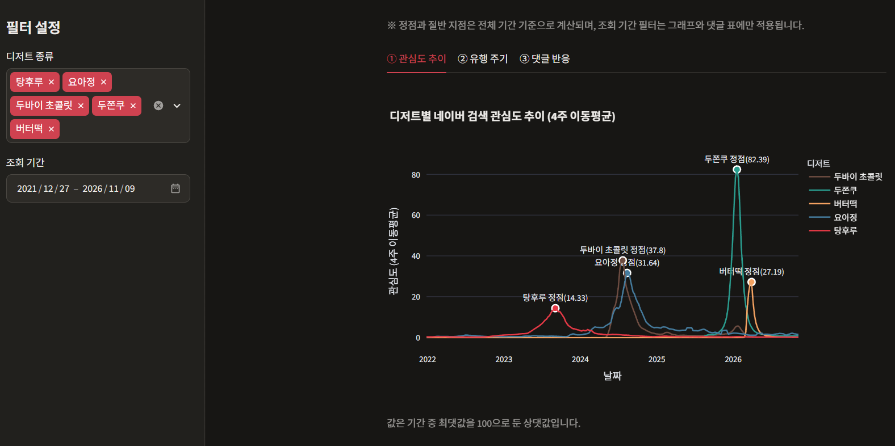

# 🍨 SNS 유행 디저트 관심도 분석 (team10)

**배포 앱 URL:** https://github.com/sunhong1009/team10

## 📌 프로젝트 소개

탕후루, 요아정, 두바이 초콜릿, 두쫀쿠, 버터떡처럼 SNS에서 유행한 디저트의 검색 관심도와 YouTube 댓글을 수집·분석해 보여 주는 Streamlit 앱입니다.

**핵심 질문**

1. SNS 유행 디저트의 검색 관심도는 정점에 도달한 뒤 얼마나 빨리 감소하는가?
2. 관심도가 정점이던 시기와 감소한 시기에 YouTube 댓글의 긍정·부정 비율은 어떻게 다른가?

**현재 단계:** 데이터 수집·익명화, 4주 이동평균 기반 유행 주기(정점·반감기) 계산, Kiwi 형태소 기반 감성분석, 3개 탭 시각화 및 Streamlit Cloud 배포까지 구현을 완료했습니다.

## 👥 팀원

| 이름 | 학번 | 담당 역할 |
| --- | --- | --- |
| 조수민 | 202606180 | 분석·시각화 |
| 호소야 코로로 | 202606258 | 앱 화면·배포·영상 |
| 이선홍 | 202606170 | 데이터 수집 |

## 앱 실행 화면



## 💻 실행 방법

앱은 수집이 완료된 `data/` 폴더의 CSV 파일을 직접 읽어 실행되므로, 별도의 API 키 설정 없이 바로 실행할 수 있습니다. (데이터를 새로 수집할 때만 수집용 컴퓨터의 `.env` 파일에 API 키를 등록합니다.)

**1. 라이브러리 설치**

```bash
pip install -r requirements.txt
```

**2. 앱 실행**

```bash
streamlit run app.py
```

## 📊 사용 데이터

| 데이터 | 출처 | 수집 및 구성 내용 |
| --- | --- | --- |
| 검색 관심도 (`data/trend.csv`) | 네이버 클라우드 플랫폼 검색어 트렌드 API (NAVER API HUB) | 2022년 1월 1일~2026년 11월 15일 디저트 5종 주간 상대값 (최고점 = 100) |
| 댓글 (`data/comments.csv`) | YouTube Data API v3 | 디저트별 관련 영상 검색 및 댓글 수집 (디저트당 300~500개, 익명화 완료) |
| 감성사전 (`data/sentiment_lexicon.csv`) | KNU 한국어 감성사전 기반 자체 보강 | 디저트 댓글 빈출 형태소(`맛있`, `비싸`, `한물` 등) 점수 사전 |

**분석 및 시기 구분 기준**

- 주간 검색량 변동성을 완화하기 위해 4주 이동평균(`ratio_ma`)을 기준으로 정점과 절반 지점(정점의 50% 이하)을 산출합니다.
- 댓글 작성일(`comment_date`)을 기준으로 정점 이전 50% 미만은 **도입기**, 정점 50% 이상~절반 지점 이전은 **정점기**, 절반 지점 이후는 **감소기**로 구분합니다.

## 사용 라이브러리

- `streamlit`: 웹 앱 화면 구성 및 클라우드 배포
- `pandas`: CSV 데이터 정리, 병합 및 필터링
- `plotly`: 관심도 추이·유행 주기·감성 비율·빈출 단어 인터랙티브 시각화
- `kiwipiepy`: 한국어 형태소 분석 기반 감성분석 및 핵심 단어 추출
- `requests`: NAVER API HUB 및 YouTube Data API 호출
- `python-dotenv`: 데이터 수집 시 `.env` 환경 변수 로드

## API 키와 개인정보 관리

- API 키는 데이터 수집 환경의 `.env` 파일에만 보관하며, `.gitignore` 설정을 통해 GitHub에는 절대 업로드하지 않습니다.
- 앱 실행 시에는 외부 API를 직접 호출하지 않고 정제된 CSV 파일만 사용합니다.
- YouTube 댓글 작성자의 이름, 채널 ID, 프로필 사진 URL은 저장하지 않으며, 채널 ID는 `user_001` 형식의 번호로 익명화한 뒤 원본을 파기합니다.
- 댓글 본문 내 `@아이디` 언급은 정규식을 통해 `@user`로 가립니다.

## 파일 구성

| 파일 | 역할 |
| --- | --- |
| `app.py` | Streamlit 메인 화면 (사이드바 필터 및 3개 탭 UI) |
| `config.py` | 디저트 5종 목록, 검색어 묶음, 그래프 공통 색상 상수 |
| `collect_naver.py` | NAVER API HUB 검색어 트렌드 수집 (`data/trend.csv` 생성) |
| `collect_youtube.py` | YouTube 댓글 수집 및 개인정보 익명화 (`data/comments.csv` 생성) |
| `analysis.py` | 이동평균, 정점·반감기 계산, 시기 구분, 감성분석, Plotly 시각화 함수 |
| `data/trend.csv` | 디저트별 주간 검색 관심도 데이터 |
| `data/comments.csv` | 익명화된 YouTube 댓글 및 작성일 데이터 |
| `data/sentiment_lexicon.csv` | 형태소 단위 감성 점수 사전 |
| `requirements.txt` | 설치할 라이브러리 목록 |
| `.gitignore` | `.env`, 캐시 파일 등 Git 업로드 제외 목록 |